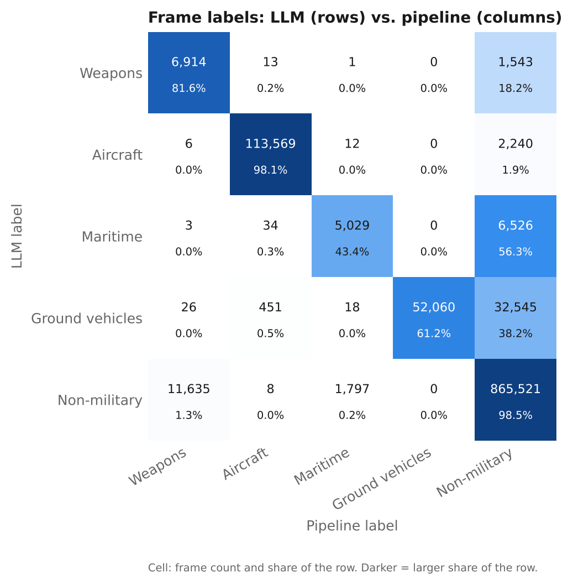
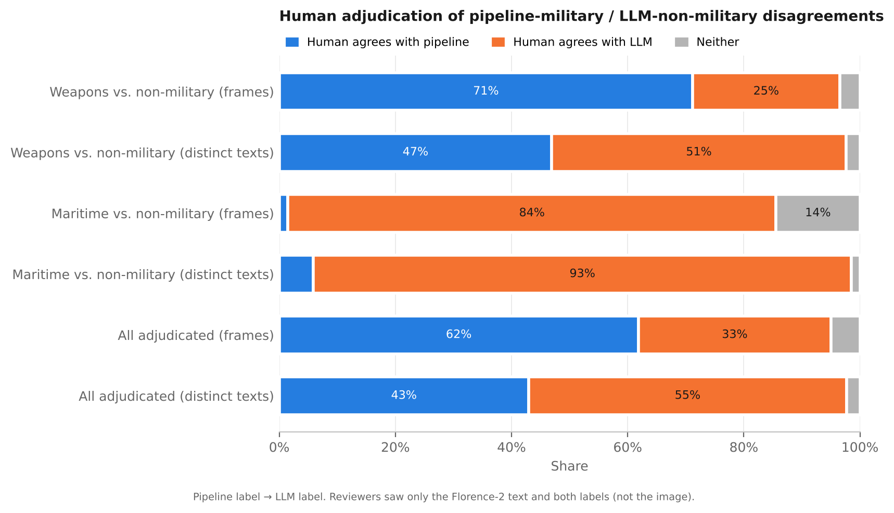
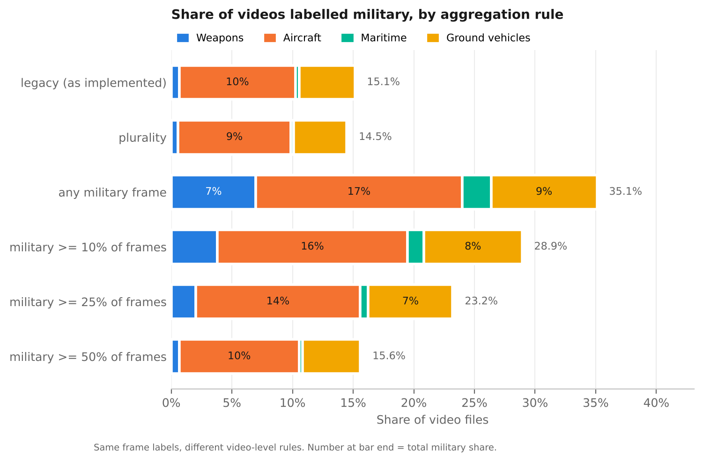
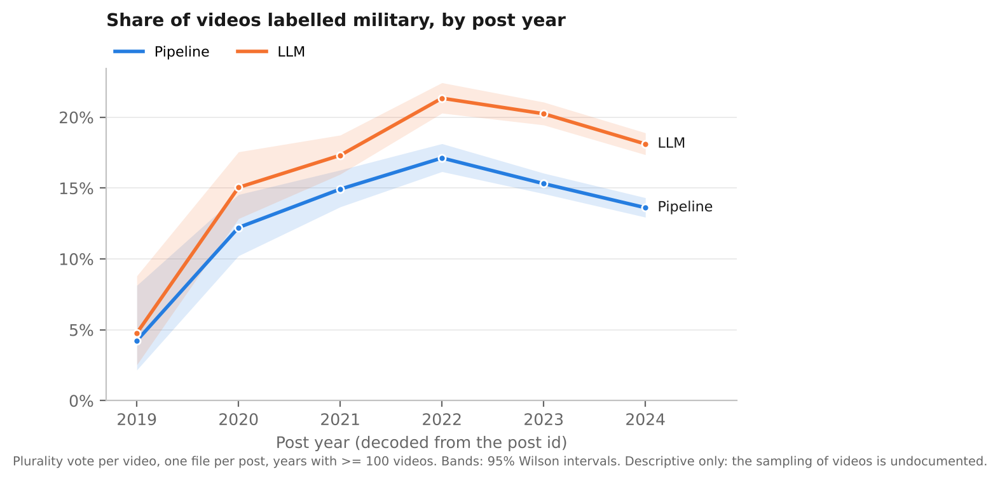
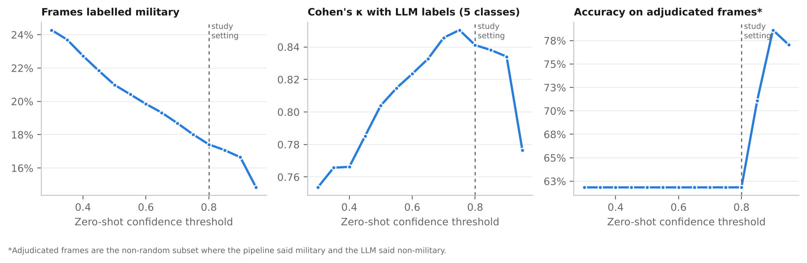

# Analysis of the archived study data

> Generated by `zsd analyze` from `data/` — do not edit by hand. Every number below is also in [`summary.json`](summary.json). Interpretation, caveats and the definitions of each quantity are in [`docs/methodology.md`](../docs/methodology.md).

Package 1.0.0 · bootstrap: 2000 replicates, seed 2025, 95% percentile intervals, resampling post id (files with the same post id form one cluster) · `frames.csv.gz` sha256 `8c30af8d266a964c…`

Terminology: **pipeline** = Florence-2 `<OD>` + keyword rule + BART-MNLI (the system studied); **LLM** = the OpenAI-model label used as a second annotator (*not* ground truth); **human** = labels from the review web app (only for a non-random subset).

## 1. Data

| Quantity | Value |
|---|---|
| Sampled frames (rows) | 1,099,951 |
| Video files processed | 30,958 (16 yielded no frames) |
| Distinct posts (after removing batch prefix) | 28,676 |
| Collection batches (file-name prefixes) | 19 |
| Distinct Florence-2 strings | 28,490 |
| Frames per file: median (IQR), max | 20 (13–39), 3,185 |
| Frames with `No object detected.` | 7,853 |
| Sampling interval | every 30th decoded frame (all frame numbers are multiples of 30) |
| Samples skipped by de-duplication / errors | 3,023 (0.27%) |
| Each string always has the same pipeline / LLM label | True / True |
| Human-labelled frames (distinct strings) | 13,440 (738) |

**Post dates.** Posts were created between 2018-07-01 and 2024-10-30 (median 2023-07-23). Creation times are not stored in the data; they are decoded from the post ids (the upper 32 bits of a TikTok id are the Unix creation time). The numeric file-name prefixes are chronological collection batches: `10` 2018-07–2021-05, `11` 2021-03–2022-02, `12` 2021-09–2022-07, `13` 2022-03–2022-10, `14` 2022-07–2023-01, `15` 2022-09–2023-04, `16` 2023-01–2023-06, `17` 2023-04–2023-08, `18` 2023-06–2023-09, `19` 2023-09–2023-11, `20` 2023-11–2024-02, `21` 2023-12–2024-04, `22` 2024-02–2024-06, `23` 2024-03–2024-08, `24` 2024-05–2024-09, `25` 2024-06–2024-09, `26` 2024-08–2024-10, `27` 2024-10–2024-10; files without a prefix span the whole period.

**Duplicate posts.** 2,266 posts were processed twice (same post id under two batch prefixes); in all 2,266 cases the frame-by-frame outputs are identical, so 72,518 frames (6.6%) are exact duplicates. Duplicated pairs: 10+<none> (813), 11+<none> (324), 27+<none> (226), 26+<none> (216) — files without a prefix that were also collected in a dated batch. Bootstrap clusters are formed by post, so duplicates do not narrow the intervals.

Label distributions (frames):

| Label | Pipeline | LLM | Human (adjudicated subset) |
|---|---|---|---|
| weapons | 18,584 (1.7%) | 8,471 (0.8%) | 8,284 |
| aircraft | 114,075 (10.4%) | 115,827 (10.5%) | 260 |
| maritime | 6,857 (0.6%) | 11,592 (1.1%) | 28 |
| ground_vehicles | 52,060 (4.7%) | 85,100 (7.7%) | 406 |
| nonmilitary | 908,375 (82.6%) | 878,961 (79.9%) | 4,462 |

## 2. Reproducibility of the stored pipeline labels

The stored label of every frame is a deterministic function of its Florence-2 string, so the legacy decision rule (`FrameClassifier(legacy=True)`, BART-MNLI, threshold 0.8) was re-run on the distinct strings. Coverage: 28,490/28,490 strings (100.0% of frames).

* Re-derived label equals the stored label for **28,490/28,490 strings (100.00%)**, i.e. 100.000% of covered frames.
* Strings whose top score is within 0.001 of the threshold (numerically fragile): 111.
* Model: `facebook/bart-large-mnli` @ `d7645e127eaf1aefc7862fd59a17a5aa8558b8ce`; transformers 4.57.6, torch 2.15.0+cpu.

## 3. Keyword rule audit

The original rule forces `ground_vehicles` when any of 18 keywords occurs as a substring of the lower-cased string. Only 1 keyword(s) ever fired: `tank` (52,060 frames, 734 strings). 4 keywords contain capitals and can never match (`APC`, `MRAP`, `Stryker`, `Bradley`). All 52,060 pipeline `ground_vehicles` frames come from the keyword rule (52,060); BART-MNLI never assigned that class at ≥ 0.8. `tank top` (clothing) triggers the rule in 28 frames.

The corrected rule (whole-word, per object label, with exclusions such as `tank top`) applied to the re-segmented strings fires on 52,031 frames: 29 frames no longer fire and 0 newly fire.

Without the keyword rule, BART-MNLI (threshold 0.8) would have labelled the 52,060 keyword frames: weapons 697, aircraft 320, maritime 161, nonmilitary 50,882.

## 4. Agreement between pipeline and LLM labels

Agreement is not accuracy: the LLM labelled the same Florence-2 strings and can be wrong in the same way.

| Unit | n | Observed agreement | Cohen's κ | Macro-F1 (LLM as reference) |
|---|---|---|---|---|
| Frames, 5 classes | 1,099,951 | 94.8% (94.6%–95.1%) | 0.841 (0.833–0.848) | 0.754 (0.743–0.767) |
| Frames, military vs. not | 1,099,951 | 94.9% (94.6%–95.1%) | 0.832 (0.824–0.840) | 0.916 (0.912–0.920) |
| Distinct strings, 5 classes | 28,490 | 89.6% (89.2%–90.0%) | 0.562 (0.548–0.575) | 0.643 (0.630–0.655) |
| Videos (plurality vote), 5 classes | 30,942 | 94.7% (94.4%–94.9%) | 0.818 (0.808–0.826) | 0.717 (0.694–0.739) |
| Videos (plurality vote), military vs. not | 30,942 | 94.7% (94.4%–95.0%) | 0.809 (0.800–0.818) | 0.904 (0.900–0.909) |

Frame-level agreement is dominated by a few very frequent, easy strings; weighting every distinct string once gives a much lower κ.

Per class (frames; precision = share of pipeline-`c` frames the LLM also called `c`):

| Class | Pipeline frames | LLM frames | Precision | Recall | F1 |
|---|---|---|---|---|---|
| weapons | 18,584 | 8,471 | 37.2% | 81.6% | 0.511 |
| aircraft | 114,075 | 115,827 | 99.6% | 98.1% | 0.988 |
| maritime | 6,857 | 11,592 | 73.3% | 43.4% | 0.545 |
| ground_vehicles | 52,060 | 85,100 | 100.0% | 61.2% | 0.759 |
| nonmilitary | 908,375 | 878,961 | 95.3% | 98.5% | 0.969 |

### Disagreements

56,858 frames disagree; 43,418 of them (76.4%) were never seen by a human.

| Pipeline → LLM | Frames | Strings | Posts | Human-reviewed | Most frequent strings (frames) |
|---|---|---|---|---|---|
| nonmilitary → ground_vehicles | 32,545 | 1432 | 3565 | 0 | `car tiretruck` (7,700); `truckwheel` (4,133); `car tiretruckwheel` (3,297) |
| weapons → nonmilitary | 11,635 | 667 | 2536 | 11,635 | `weapon` (3,436); `personweapon` (1,747); `human facemantrousers` (834) |
| nonmilitary → maritime | 6,526 | 190 | 382 | 0 | `boatperson` (3,270); `boatfootwearperson` (1,762); `boathelicopter` (213) |
| nonmilitary → aircraft | 2,240 | 369 | 622 | 0 | `airplaneposter` (221); `airplaneland vehiclewheel` (162); `helicopterpersonweapon` (145) |
| maritime → nonmilitary | 1,797 | 68 | 435 | 1,797 | `marine mammal` (790); `marine invertebrates` (285); `paddle` (260) |
| nonmilitary → weapons | 1,543 | 148 | 281 | 0 | `handgun` (713); `handgunperson` (96); `rifletripod` (68) |
| aircraft → ground_vehicles | 451 | 41 | 117 | 0 | `helicoptertruckwheel` (170); `helicopterpersontruck` (73); `helicoptertruck` (66) |
| aircraft → maritime | 34 | 12 | 11 | 0 | `airplaneboathelicopterland vehiclewheel` (8); `boatchair` (6); `boathelicoptervehicle` (6) |
| weapons → ground_vehicles | 26 | 14 | 17 | 0 | `carhelmetmantruckwheel` (5); `carhuman facemantruckwheelwoman` (3); `truckweaponwheel` (3) |

## 5. How the original study resolved disagreements

Disagreements were first passed through keyword "auto-correction" rules (`legacy/post_processing/prioritize_and_automate.py`, substring matching): 43,418 of 56,858 disagreement frames (76.4%) were resolved automatically and the remaining 13,440 went to human review (the reviewed set is exactly the unmatched set: True). The automatic label equals the **LLM** label for 43,418 frames and the pipeline label for 0: the rules never sided with the pipeline. They also encode a taxonomy decision — every truck, boat or plane is military:

| Rule keyword | → label | Frames resolved | Most frequent strings |
|---|---|---|---|
| `truck` | ground_vehicles | 33,040 | `car tiretruck`; `truckwheel`; `car tiretruckwheel` |
| `boat` | maritime | 6,605 | `boatperson`; `boatfootwearperson`; `boathelicopter` |
| `plane` | aircraft | 1,799 | `airplaneposter`; `airplaneland vehiclewheel`; `airplanefootwearperson` |
| `helicopter` | aircraft | 1,541 | `boathelicopter`; `helicoptertruckwheel`; `helicopterpersonweapon` |
| `gun` | weapons | 880 | `handgun`; `handgunperson`; `handgunhuman faceman` |
| `rifle` | weapons | 631 | `rifletripod`; `land vehiclerifle`; `car tirefootwearpersonrifle` |
| `missile` | weapons | 126 | `missiletruckwheel`; `missilerocket`; `human facemanmissiletruckwheel` |
| `jet` | aircraft | 2 | `jet skilife jacketperson` |

## 6. Human adjudication

Human labels exist for 13,440 frames (738 distinct strings). They cover exactly the disagreement cells where the pipeline said *military* and the LLM said *non-military*: aircraft → nonmilitary (8/8 frames), maritime → nonmilitary (1,797/1,797 frames), weapons → nonmilitary (11,635/11,635 frames). No agreement cell and no other disagreement cell was reviewed, so these labels cannot estimate overall accuracy or recall. Reviewers judged the Florence-2 string (not the image) and saw both system labels.

| Cell | n | Human = pipeline | Human = LLM | Neither |
|---|---|---|---|---|
| aircraft → nonmilitary | 8 frames | 0.0% (0.0%–0.0%) | 100.0% (100.0%–100.0%) | 0.0% (0.0%–0.0%) |
| aircraft → nonmilitary | 3 strings | 0.0% (0.0%–56.1%) | 100.0% (43.9%–100.0%) | 0.0% (0.0%–56.1%) |
| maritime → nonmilitary | 1,797 frames | 1.5% (0.7%–2.6%) | 84.0% (76.7%–90.2%) | 14.5% (8.5%–21.9%) |
| maritime → nonmilitary | 68 strings | 5.9% (2.3%–14.2%) | 92.6% (83.9%–96.8%) | 1.5% (0.3%–7.9%) |
| weapons → nonmilitary | 11,635 frames | 71.2% (68.1%–74.0%) | 25.3% (22.6%–28.2%) | 3.5% (2.5%–4.9%) |
| weapons → nonmilitary | 667 strings | 46.9% (43.2%–50.7%) | 50.7% (46.9%–54.5%) | 2.4% (1.5%–3.9%) |
| **all adjudicated** | 13,440 frames | 61.8% (58.6%–64.8%) | 33.2% (30.2%–36.5%) | 5.0% (3.7%–6.5%) |
| **all adjudicated** | 738 strings | 43.0% (39.4%–46.6%) | 54.7% (51.1%–58.3%) | 2.3% (1.4%–3.7%) |

Frame-level intervals: post-cluster bootstrap. String-level intervals: Wilson score.

**Label quality.** The raw session file `reviewed_mismatches.csv` (9,850 rows, 51 strings) agrees with the merged labels for 50/51 strings; strings with conflicting labels inside the session: `paddle` (aircraft, maritime). Examples where the human label matches neither system (several look implausible, e.g. `paddle` → aircraft):

| String | Pipeline | LLM | Human | Frames |
|---|---|---|---|---|
| `paddle` | maritime | nonmilitary | aircraft | 260 |
| `footwearpersonweapon` | weapons | nonmilitary | ground_vehicles | 203 |
| `vehicleweapon` | weapons | nonmilitary | ground_vehicles | 94 |
| `helmetland vehiclepersonweaponwheel` | weapons | nonmilitary | ground_vehicles | 26 |
| `car tireland vehiclemantrousers` | weapons | nonmilitary | ground_vehicles | 21 |
| `land vehiclemantrousers` | weapons | nonmilitary | ground_vehicles | 20 |
| `personvehicleweapon` | weapons | nonmilitary | ground_vehicles | 14 |
| `barrelvehicle` | weapons | nonmilitary | ground_vehicles | 7 |

## 7. Estimated precision of the pipeline's military labels

Discrepant-analysis estimate: frames where the LLM agrees are *assumed* correct, adjudicated disagreements use the human label, unadjudicated disagreements are excluded (point) or counted as all-wrong / all-right (bounds). Because agreement is assumed correct, these estimates are biased upwards.

| Pipeline label | Frames | LLM agrees | Adjudicated (human = pipeline) | Unadjudicated | Precision (95% CI) | Bounds |
|---|---|---|---|---|---|---|
| weapons | 18,584 | 6,914 | 11,635 (8,284) | 35 | 81.9% (79.7%–83.9%) | 81.8%–82.0% |
| aircraft | 114,075 | 113,569 | 8 (0) | 498 | 100.0% (100.0%–100.0%) | 99.6%–100.0% |
| maritime | 6,857 | 5,029 | 1,797 (27) | 31 | 74.1% (69.5%–78.2%) | 73.7%–74.2% |
| ground_vehicles | 52,060 | 52,060 | 0 (0) | 0 | 100.0% (100.0%–100.0%) | 100.0%–100.0% |

`ground_vehicles` shows 100% only because the LLM never contradicted a `tank` frame and none was reviewed; the `tank top` frames in §3 are known false positives.

## 8. Video-level labels and the aggregation rule

Per-file frame counts recomputed from `frames.csv.gz` match the stored per-video summary: True. Findings about the original aggregation code:

* The 16 files that yielded no frames are labelled `weapons` by the original rule (`max` over all-zero counts returns the first label).
* 193 files have a tie between a military label and `nonmilitary`; the original rule resolves every such tie towards the military label (label order). This is the only difference between the original rule and plurality voting with non-military tie-breaking (193 files).
* The "more than half non-military → non-military" override compares below-threshold *sampled* frames with half of *all decoded* frames (≈30× more), so it can only have fired for files with one or two sampled frames (at most 67 files).

| Rule | weapons | aircraft | maritime | ground_vehicles | nonmilitary |
|---|---|---|---|---|---|
| legacy (as implemented) | 203 (0.7%) | 2,971 (9.6%) | 89 (0.3%) | 1,422 (4.6%) | 26,273 (84.9%) |
| plurality | 172 (0.6%) | 2,878 (9.3%) | 79 (0.3%) | 1,347 (4.4%) | 26,466 (85.5%) |
| any military frame | 2,157 (7.0%) | 5,265 (17.0%) | 739 (2.4%) | 2,700 (8.7%) | 20,081 (64.9%) |
| military >= 10% of frames | 1,175 (3.8%) | 4,852 (15.7%) | 418 (1.4%) | 2,505 (8.1%) | 21,992 (71.1%) |
| military >= 25% of frames | 621 (2.0%) | 4,201 (13.6%) | 206 (0.7%) | 2,152 (7.0%) | 23,762 (76.8%) |
| military >= 50% of frames | 204 (0.7%) | 3,058 (9.9%) | 91 (0.3%) | 1,471 (4.8%) | 26,118 (84.4%) |
| plurality, one file per post | 166 (0.6%) | 2,772 (9.7%) | 72 (0.3%) | 1,257 (4.4%) | 24,409 (85.1%) |

The share of videos called military ranges from 14.5% (plurality) to 35.1% (any military frame): the video-level conclusion depends more on the aggregation rule than on the frame classifier.

### Military share of videos by post year (descriptive)

| Post year | Videos | Pipeline: military | LLM: military |
|---|---|---|---|
| 2018 | 29 | 3.4% (0.6%–17.2%) | 3.4% (0.6%–17.2%) |
| 2019 | 189 | 4.2% (2.2%–8.1%) | 4.8% (2.5%–8.8%) |
| 2020 | 884 | 12.2% (10.2%–14.5%) | 15.0% (12.8%–17.6%) |
| 2021 | 2,888 | 14.9% (13.7%–16.3%) | 17.3% (16.0%–18.7%) |
| 2022 | 5,595 | 17.1% (16.2%–18.1%) | 21.3% (20.3%–22.4%) |
| 2023 | 9,528 | 15.3% (14.6%–16.0%) | 20.2% (19.5%–21.1%) |
| 2024 | 9,563 | 13.6% (12.9%–14.3%) | 18.1% (17.4%–18.9%) |

Plurality vote per video, one file per post, 95% Wilson intervals. How videos were selected for collection is not documented, so these shares describe this archive, not the platform.

## 9. Sensitivity to the zero-shot confidence threshold

Labels re-derived from the stored BART-MNLI scores at other thresholds (keyword rule unchanged). Coverage: 1,099,951 frames. The last column is computed on the 13,440 adjudicated frames only (non-random subset).

| Threshold | Military share | Agreement with LLM | κ with LLM | κ military vs. not | Accuracy on adjudicated |
|---|---|---|---|---|---|
| 0.30 | 24.3% | 90.7% | 0.754 | 0.737 | 61.8% |
| 0.35 | 23.7% | 91.2% | 0.766 | 0.751 | 61.8% |
| 0.40 | 22.7% | 91.4% | 0.766 | 0.752 | 61.8% |
| 0.45 | 21.8% | 92.3% | 0.785 | 0.773 | 61.8% |
| 0.50 | 21.0% | 93.1% | 0.804 | 0.793 | 61.8% |
| 0.55 | 20.4% | 93.5% | 0.815 | 0.805 | 61.8% |
| 0.60 | 19.8% | 93.9% | 0.823 | 0.814 | 61.8% |
| 0.65 | 19.3% | 94.3% | 0.833 | 0.824 | 61.8% |
| 0.70 | 18.7% | 94.8% | 0.846 | 0.837 | 61.8% |
| 0.75 | 18.0% | 95.1% | 0.850 | 0.842 | 61.8% |
| 0.80 | 17.4% | 94.8% | 0.841 | 0.832 | 61.8% |
| 0.85 | 17.1% | 94.8% | 0.838 | 0.829 | 71.1% |
| 0.90 | 16.6% | 94.7% | 0.834 | 0.824 | 78.6% |
| 0.95 | 14.8% | 93.1% | 0.777 | 0.764 | 77.1% |
| argmax (none) | 24.6% | 90.3% | 0.746 | 0.729 | 61.8% |

## 10. Ablation: label separator and corrected keyword rule

The archived strings were re-segmented into object labels (99.80% of frames split into known labels; see `zeroshot_detector.segment`) and classified with the corrected rule (labels joined with `, `, whole-word keyword rule). Coverage: 1,046,450 frames, 4,602 strings.

|  | Original (glued strings) | Corrected (separated labels) |
|---|---|---|
| κ with LLM | 0.847 | 0.864 |
| Agreement with LLM | 94.9% | 95.5% |
| Accuracy on adjudicated frames | 61.8% | 78.1% |
| share weapons | 1.7% | 1.4% |
| share aircraft | 10.7% | 10.7% |
| share maritime | 0.6% | 0.9% |
| share ground_vehicles | 4.8% | 4.8% |
| share nonmilitary | 82.1% | 82.2% |

10,227 frames (568 strings) change label. Largest changes:

| String | Original | Corrected | Frames |
|---|---|---|---|
| `boatperson` | nonmilitary | maritime | 3270 |
| `human facemantrousers` | weapons | nonmilitary | 834 |
| `airplaneposter` | nonmilitary | aircraft | 221 |
| `helmethuman facepersonweapon` | weapons | nonmilitary | 208 |
| `human facejacketmantrousers` | weapons | nonmilitary | 207 |
| `boathuman faceperson` | maritime | nonmilitary | 185 |
| `airplaneland vehiclewheel` | nonmilitary | aircraft | 162 |
| `carhelicopterwheel` | aircraft | nonmilitary | 151 |
| `mantrousers` | weapons | nonmilitary | 151 |
| `footwearhuman facepersonrifle` | weapons | nonmilitary | 150 |

## Caveats

* There is no image-level ground truth. LLM labels are a second opinion produced from the same text; human labels exist only for one kind of disagreement and were made from text, with both system labels visible.
* The prompt and model version used to produce the LLM labels are not recorded in the repository.
* Frames are highly correlated within a video; all intervals resample whole posts.
* See `docs/methodology.md` (threats to validity) and `docs/audit.md` (defects found in the original code).
