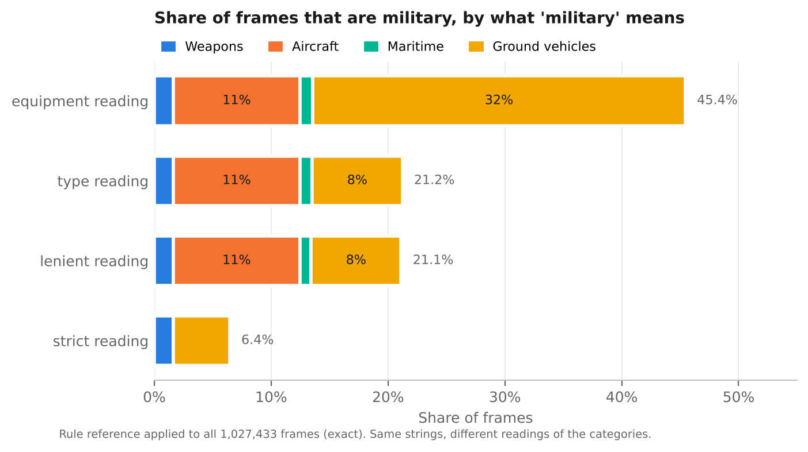
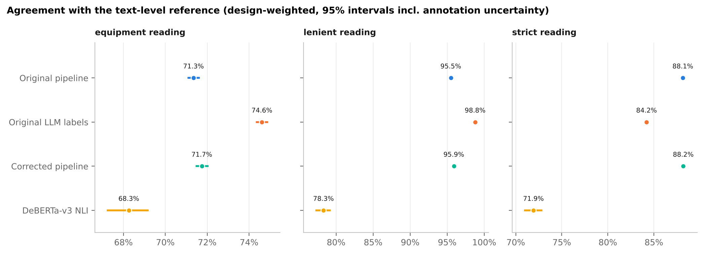
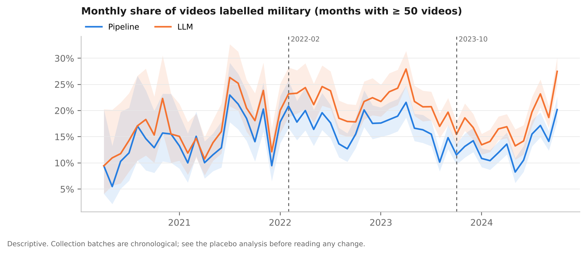

# Experiments: a text-level reference standard

> Generated by `zsd experiments report` — do not edit by hand. Plan: [`docs/experiments/PLAN.md`](../../docs/experiments/PLAN.md) (pre-registered); codebook: [`CODEBOOK.md`](../../docs/experiments/CODEBOOK.md); all numbers: [`summary.json`](summary.json).

**Terminology.** *TLR agreement* = design-weighted agreement with the text-level reference produced by language-model annotators applying the authors' codebook. It is not accuracy against what is in the video. Intervals: 95%, stratified bootstrap that also resamples annotator passes (annotation-aware), unless marked *sampling only* (2,000 replicates, seed 20251128).

## Pre-registered results

| Item | Pre-registered as | Result | Outcome |
|---|---|---|---|
| C1: lenient TLR agreement, LLM − original pipeline | confirmatory | +3.3 pp (+3.1 to +3.4) | positive; interval excludes 0 |
| C2: lenient TLR agreement, DeBERTa-v3 NLI ('military' verbalizers, separated labels, keyword rule, arg-max) − original pipeline | confirmatory | -17.2 pp (-18.1 to -16.3) | negative; interval excludes 0 |
| P1: panel departs from the rule reference on < 5% of frames (lenient) | prediction | 0.01% (0.00%–0.05%) of frames | confirmed |
| P2: LLM ahead of the pipeline under lenient, behind it under strict | prediction | lenient +3.3 pp (+3.1 to +3.4); strict -3.9 pp (-4.1 to -3.8) | confirmed |

## 1. Design and annotation

| Quantity | Value |
|---|---|
| Sample records (C / S / T strings) | 1,269 records, 1,108 strings (C: 500, S: 167, T: 441) |
| Annotator answers (by configuration) | 4,286 (A: 1380, A1: 100, B: 1380, C: 1380, D: 23, E: 23) |
| Answers from single-item fallback | 0 |
| Unresolved items per reading | equipment: 0, type: 0, lenient: 0, strict: 0 |
| Tool calls by annotators (other than the answer tool) | 0 in 270 transcripts |

Self-consistency across configurations A, B, C (Fleiss' κ on per-pass reading labels, distinct strings):

| Reading | κ (strings) | κ (design-weighted) | unanimous | κ (excl. decision-table strings) | κ (excl., design-weighted) | unanimous (excl.) |
|---|---|---|---|---|---|---|
| lenient | 0.9989 | 0.9996 | 99.91% | 0.9989 | 0.9992 | 99.91% |
| equipment | 0.9992 | 0.9998 | 99.91% | 0.9992 | 0.9997 | 99.91% |
| strict | 1.0000 | 1.0000 | 100.00% | 1.0000 | 1.0000 | 100.00% |
| type | 0.9989 | 0.9996 | 99.91% | 0.9989 | 0.9992 | 99.91% |

**Embedded checks.** Test-retest (same configuration, item re-presented under a new id): lenient 100.0%, equipment 100.0%, strict 100.0%, type 100.0% agreement over 333 pairs. Single-item vs. batched answers (configuration A): lenient 100.0%, equipment 100.0%, strict 100.0%, type 100.0%. Rule compliance on synthetic strings (lenient label correct): A 100.0% (exact primary 100.0%, scores 100.0%), B 100.0% (exact primary 100.0%, scores 100.0%), C 100.0% (exact primary 100.0%, scores 100.0%). Lenient disagreement with the reference by position in batch: 1-5: 0.0%, 6-10: 0.1%, 11-15: 0.0%, 16-20: 0.0%, 21-25: 0.0%.

**Consistency with the archived human labels** (unblinded, selective; all 211 annotated human-labelled strings): equipment reading 80.1%, lenient 92.9%, strict 92.9%. Pre-registered check (iii), the 150 human-labelled strings outside the sample: equipment 80.7%, lenient 92.7%, strict 92.7%; the 61 human-labelled sample strings: equipment 78.7%, lenient 93.4%, strict 93.4%. By which system the human had sided with (lenient, all): human=llm 100.0%, human=pipeline 89.7%, neither 0.0%. This is consistency, not validation.

## 2. RQ1: what 'military' means

Rule reference over the **whole population** (exact; first computed and committed before annotation). Recomputed after the toy-rule fix (see Deviations): 6 strings (11 frames) differ from the committed lenient labels.

| Reading | Military share | Pipeline agreement (κ) | LLM agreement (κ) |
|---|---|---|---|
| equipment | 45.4% | 71.3% (0.453) | 74.7% (0.522) |
| type | 21.2% | 95.5% (0.867) | 98.9% (0.970) |
| lenient | 21.1% | 95.5% (0.865) | 98.8% (0.967) |
| strict | 6.4% | 88.1% (0.479) | 84.2% (0.373) |

**Where the LLM − pipeline difference comes from** (*post hoc*, added after seeing the results; exact, rule reference over the population). Strings are grouped by their equipment-reading category; 'no equipment category' includes strings whose only vehicle label is the generic `vehicle`, toys, and `rocket`/`knife` that do not meet their condition. Contributions add up to the total difference in agreement.

| Object group | Frame share | lenient (pp) | strict (pp) |
|---|---|---|---|
| ground_vehicles: truck | 2.9% | +2.91 | -2.89 |
| weapons | 1.6% | -0.64 | -0.64 |
| maritime | 1.1% | +0.53 | -0.57 |
| no equipment category | 54.6% | +0.38 | +0.38 |
| aircraft | 10.9% | +0.13 | -0.21 |
| ground_vehicles: other | 24.2% | +0.04 | +0.04 |
| ground_vehicles: tank | 4.7% | +0.00 | +0.00 |
| **total** | 100.0% | **+3.34** | **-3.89** |

**Codebook sensitivity** (*post hoc*; exact, lenient reading over the population). Each row moves a group of dual-use labels from tier T2 (score 2 alone: plausibly military) to tier T1 (score 0 alone, 2 with a military cue) and recomputes the rule reference.

| Codebook | Frames relabelled | Military share | Pipeline | LLM | LLM − pipeline |
|---|---|---|---|---|---|
| codebook v2 | 0.0% | 21.1% | 95.5% | 98.8% | +3.3 pp |
| trucks as T1 | 2.9% | 18.2% | 98.4% | 95.9% | -2.5 pp |
| boats as T1 | 0.9% | 20.2% | 95.6% | 97.9% | +2.3 pp |
| aircraft as T1 | 10.8% | 10.4% | 85.0% | 88.2% | +3.2 pp |
| all dual-use as T1 | 14.7% | 6.4% | 88.1% | 84.2% | -3.9 pp |

Panel reference vs. rule reference (design-weighted agreement; prediction P1: departure < 5% under lenient):

| Reading | Panel = rule reference |
|---|---|
| lenient | 99.99% (99.95%–100.00%) |
| equipment | 99.99% (99.95%–100.00%) |
| strict | 100.00% (100.00%–100.00%) |
| type | 99.99% (99.95%–100.00%) |

## 3. RQ2 / RQ3: agreement with the reference

### Lenient reading (primary)

| System | TLR agreement | (sampling only) | κ | macro-F1 | military share (system) |
|---|---|---|---|---|---|
| Original pipeline | 95.5% (95.4%–95.6%) | 95.5% (95.4%–95.6%) | 0.865 (0.862–0.868) | 0.819 (0.811–0.825) | 17.7% |
| Original LLM labels | 98.8% (98.6%–98.9%) | 98.8% (98.6%–98.9%) | 0.965 (0.962–0.968) | 0.911 (0.906–0.917) | 20.4% |
| Corrected pipeline (separated labels, corrected keyword rule, BART, τ=0.8) | 95.9% (95.8%–96.0%) | 95.9% (95.8%–96.0%) | 0.877 (0.873–0.882) | 0.874 (0.867–0.879) | 17.6% |
| DeBERTa-v3 NLI, 'military' verbalizers, separated labels, keyword rule, arg-max | 78.3% (77.3%–79.2%) | 78.3% (77.3%–79.2%) | 0.528 (0.514–0.541) | 0.641 (0.621–0.658) | 34.4% |
| Rule reference (deterministic codebook) | 100.0% (99.9%–100.0%) | 100.0% (100.0%–100.0%) | 1.000 (0.999–1.000) | 0.999 (0.998–1.000) | 21.1% |

Reference prevalence (TLR, design-weighted): weapons 1.6% (1.6%–1.7%), aircraft 10.8% (10.8%–10.9%), maritime 1.0% (0.9%–1.0%), ground_vehicles 7.7% (7.6%–7.7%), nonmilitary 78.9% (78.8%–79.0%).
Class shares of each system (RQ3, design-weighted; the same under every reading): Original pipeline: weapons 1.7%, aircraft 10.6%, maritime 0.6%, ground_vehicles 4.8%, nonmilitary 82.3%; Original LLM labels: weapons 0.8%, aircraft 10.8%, maritime 1.1%, ground_vehicles 7.7%, nonmilitary 79.6%; Corrected pipeline: weapons 1.4%, aircraft 10.5%, maritime 0.9%, ground_vehicles 4.8%, nonmilitary 82.4%; DeBERTa-v3 NLI: weapons 2.1%, aircraft 8.6%, maritime 8.1%, ground_vehicles 15.6%, nonmilitary 65.6%.

| Contrast (paired) | Difference | (sampling only) |
|---|---|---|
| llm - pipeline: agreement | +3.3 pp (+3.1 to +3.4) | +3.3 pp (+3.1 to +3.4) |
| llm - pipeline: binary_agreement | +3.4 pp (+3.3 to +3.6) | +3.4 pp (+3.3 to +3.6) |
| deberta_military_separated - pipeline: agreement | -17.2 pp (-18.1 to -16.3) | -17.2 pp (-18.2 to -16.3) |
| deberta_military_separated - pipeline: binary_agreement | -16.9 pp (-17.8 to -16.0) | -16.9 pp (-17.9 to -16.0) |
| corrected_pipeline - pipeline: agreement | +0.4 pp (+0.3 to +0.6) | +0.4 pp (+0.3 to +0.5) |
| corrected_pipeline - pipeline: binary_agreement | +0.4 pp (+0.3 to +0.6) | +0.4 pp (+0.3 to +0.5) |

### Equipment reading

| System | TLR agreement | (sampling only) | κ | macro-F1 | military share (system) |
|---|---|---|---|---|---|
| Original pipeline | 71.3% (71.1%–71.6%) | 71.3% (71.1%–71.6%) | 0.453 (0.449–0.456) | 0.686 (0.681–0.691) | 17.7% |
| Original LLM labels | 74.6% (74.4%–74.9%) | 74.6% (74.4%–74.9%) | 0.520 (0.516–0.523) | 0.756 (0.751–0.760) | 20.4% |
| Corrected pipeline (separated labels, corrected keyword rule, BART, τ=0.8) | 71.7% (71.5%–72.0%) | 71.7% (71.5%–72.0%) | 0.460 (0.456–0.464) | 0.742 (0.737–0.747) | 17.6% |
| DeBERTa-v3 NLI, 'military' verbalizers, separated labels, keyword rule, arg-max | 68.3% (67.2%–69.2%) | 68.3% (67.2%–69.1%) | 0.454 (0.439–0.468) | 0.624 (0.603–0.640) | 34.4% |
| Rule reference (deterministic codebook) | 100.0% (99.9%–100.0%) | 100.0% (100.0%–100.0%) | 1.000 (0.999–1.000) | 0.999 (0.998–1.000) | 45.4% |

Reference prevalence (TLR, design-weighted): weapons 1.6% (1.6%–1.7%), aircraft 10.9% (10.8%–10.9%), maritime 1.1% (1.1%–1.1%), ground_vehicles 31.8% (31.6%–32.1%), nonmilitary 54.6% (54.4%–54.9%).

| Contrast (paired) | Difference | (sampling only) |
|---|---|---|
| llm - pipeline: agreement | +3.3 pp (+3.1 to +3.4) | +3.3 pp (+3.1 to +3.4) |
| llm - pipeline: binary_agreement | +3.4 pp (+3.2 to +3.5) | +3.4 pp (+3.2 to +3.5) |
| deberta_military_separated - pipeline: agreement | -3.1 pp (-4.1 to -2.2) | -3.1 pp (-4.1 to -2.2) |
| deberta_military_separated - pipeline: binary_agreement | -2.8 pp (-3.8 to -1.9) | -2.8 pp (-3.9 to -1.9) |
| corrected_pipeline - pipeline: agreement | +0.4 pp (+0.3 to +0.6) | +0.4 pp (+0.3 to +0.5) |
| corrected_pipeline - pipeline: binary_agreement | +0.3 pp (+0.2 to +0.5) | +0.3 pp (+0.2 to +0.5) |

### Strict reading

| System | TLR agreement | (sampling only) | κ | macro-F1 | military share (system) |
|---|---|---|---|---|---|
| Original pipeline | 88.1% (88.1%–88.2%) | 88.1% (88.1%–88.2%) | 0.478 (0.473–0.483) | 0.693 (0.687–0.699) | 17.7% |
| Original LLM labels | 84.2% (84.1%–84.3%) | 84.2% (84.1%–84.3%) | 0.370 (0.367–0.373) | 0.575 (0.570–0.580) | 20.4% |
| Corrected pipeline (separated labels, corrected keyword rule, BART, τ=0.8) | 88.2% (88.1%–88.3%) | 88.2% (88.1%–88.3%) | 0.478 (0.472–0.483) | 0.707 (0.703–0.711) | 17.6% |
| DeBERTa-v3 NLI, 'military' verbalizers, separated labels, keyword rule, arg-max | 71.9% (71.0%–72.8%) | 71.9% (70.9%–72.8%) | 0.258 (0.249–0.266) | 0.538 (0.512–0.558) | 34.4% |
| Rule reference (deterministic codebook) | 100.0% (100.0%–100.0%) | 100.0% (100.0%–100.0%) | 1.000 (1.000–1.000) | 1.000 (1.000–1.000) | 6.4% |

Reference prevalence (TLR, design-weighted): weapons 1.6% (1.6%–1.7%), aircraft 0.0% (0.0%–0.0%), maritime 0.0% (0.0%–0.0%), ground_vehicles 4.8% (4.7%–4.8%), nonmilitary 93.6% (93.5%–93.7%).

| Contrast (paired) | Difference | (sampling only) |
|---|---|---|
| llm - pipeline: agreement | -3.9 pp (-4.1 to -3.8) | -3.9 pp (-4.1 to -3.8) |
| llm - pipeline: binary_agreement | -3.9 pp (-4.0 to -3.8) | -3.9 pp (-4.0 to -3.8) |
| deberta_military_separated - pipeline: agreement | -16.2 pp (-17.1 to -15.3) | -16.2 pp (-17.2 to -15.4) |
| deberta_military_separated - pipeline: binary_agreement | -16.2 pp (-17.1 to -15.3) | -16.2 pp (-17.2 to -15.3) |
| corrected_pipeline - pipeline: agreement | +0.1 pp (-0.1 to +0.2) | +0.1 pp (-0.1 to +0.2) |
| corrected_pipeline - pipeline: binary_agreement | +0.1 pp (-0.1 to +0.2) | +0.1 pp (-0.1 to +0.2) |

### Type reading

| System | TLR agreement | (sampling only) | κ | macro-F1 | military share (system) |
|---|---|---|---|---|---|
| Original pipeline | 95.5% (95.4%–95.6%) | 95.5% (95.4%–95.6%) | 0.866 (0.863–0.869) | 0.826 (0.821–0.831) | 17.7% |
| Original LLM labels | 98.8% (98.7%–98.9%) | 98.8% (98.7%–99.0%) | 0.967 (0.964–0.970) | 0.917 (0.913–0.922) | 20.4% |
| Corrected pipeline (separated labels, corrected keyword rule, BART, τ=0.8) | 95.9% (95.8%–96.1%) | 95.9% (95.8%–96.1%) | 0.879 (0.874–0.883) | 0.879 (0.874–0.885) | 17.6% |
| DeBERTa-v3 NLI, 'military' verbalizers, separated labels, keyword rule, arg-max | 78.3% (77.3%–79.1%) | 78.3% (77.3%–79.1%) | 0.528 (0.513–0.541) | 0.641 (0.620–0.658) | 34.4% |
| Rule reference (deterministic codebook) | 100.0% (99.9%–100.0%) | 100.0% (100.0%–100.0%) | 1.000 (0.999–1.000) | 0.999 (0.998–1.000) | 21.2% |

Reference prevalence (TLR, design-weighted): weapons 1.6% (1.6%–1.7%), aircraft 10.9% (10.8%–10.9%), maritime 1.0% (1.0%–1.0%), ground_vehicles 7.7% (7.6%–7.7%), nonmilitary 78.8% (78.7%–78.9%).

| Contrast (paired) | Difference | (sampling only) |
|---|---|---|
| llm - pipeline: agreement | +3.3 pp (+3.2 to +3.5) | +3.3 pp (+3.2 to +3.5) |
| llm - pipeline: binary_agreement | +3.5 pp (+3.3 to +3.6) | +3.5 pp (+3.3 to +3.6) |
| deberta_military_separated - pipeline: agreement | -17.3 pp (-18.2 to -16.4) | -17.3 pp (-18.3 to -16.4) |
| deberta_military_separated - pipeline: binary_agreement | -16.9 pp (-17.9 to -16.1) | -16.9 pp (-18.0 to -16.1) |
| corrected_pipeline - pipeline: agreement | +0.4 pp (+0.3 to +0.6) | +0.4 pp (+0.3 to +0.5) |
| corrected_pipeline - pipeline: binary_agreement | +0.4 pp (+0.3 to +0.6) | +0.4 pp (+0.3 to +0.5) |

Per-class precision / recall under the lenient reading (the other readings are in `summary.json`):

| System | Class | Precision | Recall |
|---|---|---|---|
| Original pipeline | weapons | 83.2% (79.8%–86.6%) | 87.1% (85.7%–88.3%) |
| Original pipeline | aircraft | 99.8% (99.2%–100.0%) | 97.8% (97.1%–98.4%) |
| Original pipeline | maritime | 66.7% (62.1%–70.3%) | 43.2% (41.3%–44.9%) |
| Original pipeline | ground_vehicles | 99.0% (97.9%–100.0%) | 61.5% (61.0%–62.1%) |
| Original pipeline | nonmilitary | 95.2% (95.2%–95.2%) | 99.3% (99.2%–99.4%) |
| Original LLM labels | weapons | 97.4% (95.8%–98.6%) | 47.2% (45.4%–49.3%) |
| Original LLM labels | aircraft | 99.3% (98.7%–99.7%) | 98.8% (98.1%–99.3%) |
| Original LLM labels | maritime | 90.6% (87.3%–93.5%) | 99.9% (99.9%–99.9%) |
| Original LLM labels | ground_vehicles | 98.2% (97.1%–99.2%) | 99.2% (99.1%–99.3%) |
| Original LLM labels | nonmilitary | 98.9% (98.8%–99.0%) | 99.8% (99.7%–99.9%) |
| Corrected pipeline | weapons | 97.1% (95.3%–97.9%) | 85.2% (82.8%–87.3%) |
| Corrected pipeline | aircraft | 99.9% (99.8%–100.0%) | 96.9% (95.8%–98.0%) |
| Corrected pipeline | maritime | 76.9% (73.7%–79.9%) | 72.0% (68.7%–75.1%) |
| Corrected pipeline | ground_vehicles | 99.0% (97.9%–100.0%) | 61.5% (61.0%–62.1%) |
| Corrected pipeline | nonmilitary | 95.4% (95.3%–95.5%) | 99.6% (99.5%–99.7%) |
| DeBERTa-v3 NLI | weapons | 76.2% (62.1%–87.5%) | 100.0% (100.0%–100.0%) |
| DeBERTa-v3 NLI | aircraft | 99.6% (99.5%–99.7%) | 78.7% (77.7%–79.8%) |
| DeBERTa-v3 NLI | maritime | 3.9% (3.7%–4.2%) | 32.9% (30.5%–35.4%) |
| DeBERTa-v3 NLI | ground_vehicles | 40.2% (38.0%–42.4%) | 81.8% (80.3%–83.1%) |
| DeBERTa-v3 NLI | nonmilitary | 93.8% (93.6%–94.1%) | 78.0% (76.8%–79.1%) |

### Sensitivity (lenient reading; point estimate and sampling-only interval, 500 replicates)

| Analysis | Pipeline | LLM | Unresolved records (excluded) |
|---|---|---|---|
| weapon_first_primary | 95.5% (95.4%–95.6%) | 98.8% (98.7%–98.9%) | 0 |
| bare_dual_use_score_1 | 87.5% (87.4%–87.6%) | 90.7% (90.6%–90.8%) | 0 |
| bare_dual_use_score_2 | 95.5% (95.4%–95.6%) | 98.8% (98.7%–98.9%) | 0 |
| bare_dual_use_score_3 | 95.5% (95.4%–95.6%) | 98.8% (98.7%–98.9%) | 0 |
| excluding_depictions | 95.6% (95.5%–95.7%) | 98.9% (98.8%–99.0%) | 0 |
| without_config_A | 95.5% (95.4%–95.6%) | 98.8% (98.7%–98.9%) | 1 |
| without_config_B | 95.5% (95.4%–95.6%) | 98.8% (98.7%–98.9%) | 1 |
| without_config_C | 95.5% (95.4%–95.6%) | 98.8% (98.7%–98.9%) | 0 |

Unresolved records arise when leaving out a configuration leaves an item tied; they are excluded from that row (no tie-break pass is run for a sensitivity analysis).

### Influence of the 25 heaviest strings (lenient)

Each string's lenient label is flipped (military ↔ non-military) and the outcomes recomputed. Strings whose flip moves C1 (LLM − pipeline) by at least 0.5 pp: `car tiretruck` (-1.4 pp). Strings whose flip moves C2 (DeBERTa − pipeline) by at least 0.5 pp: `vehicle` (+4.7 pp), `carwheel` (+2.9 pp), `poster` (+2.3 pp), `airplane` (+3.2 pp).

| String | Frame share | Reference | Vote share | Δ pipeline | Δ LLM | Δ C1 | Δ C2 |
|---|---|---|---|---|---|---|---|
| `helicopter` | 6.2% | aircraft | 100.0% | -6.2 pp | -6.2 pp | +0.0 pp | +0.0 pp |
| `person` | 4.8% | nonmilitary | 100.0% | -4.8 pp | -4.8 pp | +0.0 pp | -0.0 pp |
| `vehicle` | 4.7% | nonmilitary | 100.0% | -4.7 pp | -4.7 pp | +0.0 pp | +4.7 pp |
| `human faceman` | 4.1% | nonmilitary | 100.0% | -4.1 pp | -4.1 pp | -0.0 pp | -0.0 pp |
| `land vehicle` | 3.8% | nonmilitary | 100.0% | -3.8 pp | -3.8 pp | -0.0 pp | -0.0 pp |
| `carwheel` | 2.9% | nonmilitary | 100.0% | -2.9 pp | -2.9 pp | -0.0 pp | +2.9 pp |
| `tank` | 2.7% | ground_vehicles | 100.0% | -2.7 pp | -2.7 pp | +0.0 pp | +0.0 pp |
| `human faceperson` | 2.4% | nonmilitary | 100.0% | -2.4 pp | -2.4 pp | +0.0 pp | +0.0 pp |
| `car` | 2.4% | nonmilitary | 100.0% | -2.4 pp | -2.4 pp | -0.0 pp | -0.0 pp |
| `poster` | 2.3% | nonmilitary | 100.0% | -2.3 pp | -2.3 pp | +0.0 pp | +2.3 pp |
| `land vehiclewheel` | 1.9% | nonmilitary | 100.0% | -1.9 pp | -1.9 pp | -0.0 pp | -0.0 pp |
| `airplane` | 1.6% | aircraft | 100.0% | -1.6 pp | -1.6 pp | -0.0 pp | +3.2 pp |
| `human facewoman` | 1.2% | nonmilitary | 100.0% | -1.2 pp | -1.2 pp | +0.0 pp | +0.0 pp |
| `footwearperson` | 1.1% | nonmilitary | 100.0% | -1.1 pp | -1.1 pp | -0.0 pp | -0.0 pp |
| `television` | 1.0% | nonmilitary | 100.0% | -1.0 pp | -1.0 pp | +0.0 pp | +0.0 pp |
| `carcar tire` | 1.0% | nonmilitary | 100.0% | -1.0 pp | -1.0 pp | -0.0 pp | -0.0 pp |
| `tankwheel` | 0.8% | ground_vehicles | 100.0% | -0.8 pp | -0.8 pp | -0.0 pp | -0.0 pp |
| `No object detected.` | 0.7% | nonmilitary | n/a (not annotated) | -0.7 pp | -0.7 pp | +0.0 pp | +0.0 pp |
| `human facemanwoman` | 0.7% | nonmilitary | 100.0% | -0.7 pp | -0.7 pp | -0.0 pp | -0.0 pp |
| `car tiretruck` | 0.7% | ground_vehicles | 100.0% | +0.7 pp | -0.7 pp | -1.4 pp | -0.0 pp |
| `mobile phone` | 0.6% | nonmilitary | 100.0% | -0.6 pp | -0.6 pp | +0.0 pp | +0.0 pp |
| `carvehicle registration platewheel` | 0.6% | nonmilitary | 100.0% | -0.6 pp | -0.6 pp | -0.0 pp | -0.0 pp |
| `carcar tirewheel` | 0.6% | nonmilitary | 100.0% | -0.6 pp | -0.6 pp | +0.0 pp | +0.0 pp |
| `helicopterperson` | 0.5% | aircraft | 100.0% | -0.5 pp | -0.5 pp | +0.0 pp | +0.0 pp |
| `glasseshuman faceman` | 0.5% | nonmilitary | 100.0% | -0.5 pp | -0.5 pp | -0.0 pp | -0.0 pp |

## 4. RQ4: better string classifiers? (lenient reading)

Top 15 of the exploratory grid (all configurations are in `summary.json`), as differences from the original pipeline:

| Configuration | Keyword rule | Threshold | TLR agreement | κ | Δ vs pipeline |
|---|---|---|---|---|---|
| bart-example-ids-separated | on | 0.55 | 96.4% | 0.897 | +0.9 pp |
| bart-image-ids-separated | on | 0.7 | 96.4% | 0.896 | +0.9 pp |
| bart-example-ids-separated | on | 0.6 | 96.4% | 0.894 | +0.9 pp |
| bart-example-ids-separated | on | 0.75 | 96.4% | 0.892 | +0.9 pp |
| bart-example-ids-separated | on | 0.65 | 96.3% | 0.894 | +0.9 pp |
| bart-image-ids-separated | on | 0.65 | 96.3% | 0.895 | +0.9 pp |
| bart-example-ids-separated | on | 0.7 | 96.3% | 0.893 | +0.8 pp |
| bart-image-ids-separated | on | 0.75 | 96.0% | 0.881 | +0.5 pp |
| bart-example-ids-separated | on | 0.8 | 95.9% | 0.877 | +0.4 pp |
| bart-example-ids-separated | on | 0.5 | 95.8% | 0.882 | +0.4 pp |
| bart-image-ids-glued | on | 0.65 | 95.8% | 0.883 | +0.4 pp |
| bart-example-ids-separated | on | 0.85 | 95.8% | 0.874 | +0.3 pp |
| bart-image-ids-glued | on | 0.6 | 95.8% | 0.883 | +0.3 pp |
| bart-image-ids-separated | on | 0.8 | 95.7% | 0.872 | +0.2 pp |
| bart-example-ids-glued | on | 0.75 | 95.7% | 0.874 | +0.2 pp |

Best setting per model (selected on the same sample, so optimistic): bart: bart-example-ids-separated, keyword rule on, threshold 0.55, 96.4% (+0.9 pp); deberta: deberta-example-ids-glued, keyword rule on, threshold 0.95, 92.1% (-3.4 pp).

Nested selection (choose on 4 folds of strings, evaluate on the 5th): out-of-fold TLR agreement 96.2%; chosen: bart-example-ids-separated/kw/0.55; bart-example-ids-separated/kw/0.55; bart-example-ids-separated/kw/0.55; bart-example-ids-separated/kw/0.55; bart-example-ids-separated/kw/0.75.

Supervised bag-of-labels logistic regression trained on the reference strings (grouped 5-fold CV, 1108 strings): out-of-fold TLR agreement 99.9% (κ 0.996). Weakly supervised on the original LLM labels (cross-fitted over all strings): 98.8% (κ 0.965). Baselines: all non-military 78.9%; rule reference 100.0%; a single annotator configuration (A) 100.0%.

## 5. RQ5 (exploratory): composition around two dates

| Labels | Date | GLM step (log-odds) | Placebo percentile of abs(step) | Within straddling batches | Between batches | Straddling batches | Reported as change |
|---|---|---|---|---|---|---|---|
| pipeline | 2022-02-24 | 0.971 | 73.3% | +22.1 pp | -1.4 pp | 12 | no |
| pipeline | 2023-10-07 | 0.302 | 31.1% | +5.6 pp | -3.5 pp | 19, none | no |
| llm | 2022-02-24 | 0.728 | 68.9% | +22.6 pp | +1.5 pp | 12 | no |
| llm | 2023-10-07 | 0.114 | 11.1% | +4.8 pp | -4.0 pp | 19, none | no |

A change is reported only if the step exceeds the 95th percentile of the absolute placebo steps (every month from 2020-06 to 2024-04 except the event months; window ±18 months, event month excluded) and has the same sign within and between batches (pre-registered). Straddling batch `none` = videos without a batch prefix. pipeline labels: 45 placebo months, of which 2023-09 (12.2), 2023-11 (12.7) give degenerate steps (separation); the 95th percentile is 1.49 with them and 1.27 without them, and no event step exceeds either; llm labels: 45 placebo months, of which 2023-09 (12.8), 2023-11 (13.3) give degenerate steps (separation); the 95th percentile is 1.33 with them and 1.11 without them, and no event step exceeds either.

## Deviations from the plan

* Before the sample was drawn, two of the twelve synthetic check strings (`airplanerocket`, `helmetmotorcycleperson`) turned out to occur in the archive. The materials build stopped on the resulting duplicate item id. They were replaced by two absent strings that test the same rules (`jet skirifle`, `helmetpersonsuv`), and a guard was added. The draw itself was not inspected before the fix.
* The plan mentions "the 24 strings carrying more than 0.5% of frames". One of them is `No object detected.`, which is assigned deterministically and never annotated, so 23 strings received the extra passes D and E.
* No item was tied under any reading after passes A–C (and D–E for the heavy strings), so the pre-registered tie-break pass was not needed and was not run.
* An adversarial code review found six implementation errors after annotation and before the final results; all were fixed before any reported number was computed: (i) the annotation-aware bootstrap dropped the never-annotated `No object detected.` stratum from every replicate; (ii) the weapon-first sensitivity analysis also overrode the tank (T3) rule instead of only the armament rule; (iii) sensitivity analyses (a) and (d) dropped the same stratum; (iv) the pre-registered design-weighted Fleiss' κ was missing; (v) in RQ5, duplicated posts took their batch from the row order instead of preferring the dated batch; (vi) the RQ5 within-batch change pooled the straddling batches instead of combining per-batch changes. These were coding errors; the plan was not changed.
* The column `rule_primary_weapon_first` in `data/reference/strings.csv.gz` was generated before fix (ii) and is therefore wrong for tank strings. It is not used by any reported analysis. The materials were not regenerated, so that their committed checksums stay valid.
* Under the rule reference, the string `boatsail` (9 frames) is non-military because the segmenter left it unsplit. All three annotator configurations read it as a boat. The label table was not changed after seeing this; the case is reported as the only panel–rule departure. The same segmentation limit leaves 69 strings (98 frames, 0.01%) with a glued token that contains an equipment word (e.g. `boatmotorperson`, `helicopterhelicopters`); the rule reference treats these tokens as non-equipment.
* The codebook's score-0 anchor mentions "generic objects", while its label table gives the generic `aircraft` and `watercraft` tier T2 (score 2 when alone). The rule reference follows the table; this affects 11 frames.
* RQ5: the v1 version of the temporal analysis (Newcombe and Newey–West intervals) was computed after the v1 plan had been drafted and before it was committed. The v2 method (batch decomposition, batch fixed effects, placebo calibration) was adopted after the design review showed, on placebo months, that the v1 intervals had a 34–60% false-positive rate.
* The original setting of the zero-shot grid (BART, "This example is {}.", identifier labels, glued input) was not re-scored. Its scores were taken from the full re-derivation of the archived labels (`results/relabel/legacy_bart-large-mnli.csv.gz`), which uses the same model revision and the same input.
* No human audit of the reference was possible. As stated in the plan, the panel's own error rate is therefore not estimated.
* Added after seeing the results (post hoc, not pre-registered): an exact decomposition of the LLM − pipeline agreement difference by object group under the rule reference (REPORT §2). It shows that 2.9 of the 3.3 pp lenient difference comes from strings containing `truck`. Also post hoc: a codebook sensitivity table that moves each group of dual-use labels from tier T2 to T1 and recomputes the exact rule reference (REPORT §2).
* The independent re-derivation of the headline claims (a re-implementation of the codebook written without the project code) found an error in the rule reference: the toy rule counted equipment items before applying the parent and conditional rules, so `land vehicle` + `tank` + `toy` counted as two items and the toy rule did not fire. After the fix the two implementations agree on every string under every reading. The fix changes the rule label of 14 strings (30 frames) under the equipment reading, 6 strings (11 frames) under lenient and 3 (7 frames) under strict; none of them is in the annotated sample, and no reported number changes at the precision shown. The report recomputes the rule labels with the corrected code; `data/reference/strings.csv.gz` keeps the labels committed before annotation, so that its checksum stays valid.
* The codebook's score 3 anchor ("or the armament rule applies") does not say which vehicle categories it covers when a weapon is listed with two vehicle types and no person. The implementation gives score 3 to every vehicle category present. This affects the score of a non-primary category in 4 strings (5 frames) and no reading label.
* Check (iii), consistency with the archived human labels: the report pools the 150 pre-registered human-labelled strings outside the sample with the 61 human-labelled sample strings (211 strings) and also reports the pre-registered 150 separately.
* Check (i), test-retest: 111 items per configuration were re-presented, of which 23 (21%), not half, are heavy strings, because only 23 heavy strings are annotated and each was used once.
* Sensitivity analyses (a)–(d) use 500 bootstrap replicates (sampling only) and are computed for the pipeline and the LLM labels only. In (d), leaving out configuration A or B leaves `dollhelicopterhuman face` tied under lenient; it is excluded from those two rows without a tie-break pass.
* PLAN §6 promised SHA-256 sums for the raw annotator answers; they were not recorded when the files were archived. They were recorded afterwards in `data/reference/raw/SHA256SUMS` (each file was committed once and has not changed since). The codebook and `instruction.md` point to `data/reference/raw/MANIFEST.json`; the manifest is `data/reference/MANIFEST.json`. Both files are frozen and were not edited.
* RQ5: the placebo distribution excludes the two event months (45 of the 47 months from 2020-06 to 2024-04). Two placebo months give degenerate GLM steps (separation); they are kept, as the plan specifies, and the report also gives the 95th percentile without them.
* PLAN §7's per-category median scores and ≥2-pass category sets are computed during adjudication but no outcome uses them; each reading's reference label is the majority of per-pass reading labels, as pre-registered.
* The final independent verification found reporting gaps in the first rendering of the report, which were fixed: the influence table showed 15 of the 25 pre-registered strings and lacked the change in C2; the RQ3 class shares of each system, the sampling-only intervals of the contrasts and two pre-registered limitations (correlated annotator errors; no video-level agreement) were missing. No estimate changed.

## Limitations

* The reference is produced by language models applying the authors' codebook; its error rate against human judgement is not estimated.
* It is text-level: detector errors, toys, video games and museum pieces are invisible unless the object list says so.
* The annotators' errors may be correlated with each other and with the original OpenAI labeller, which would bias RQ2, including C1, towards the LLM.
* Video-level agreement is not estimated.
* Intervals cover sampling and annotation uncertainty for this archive only.
